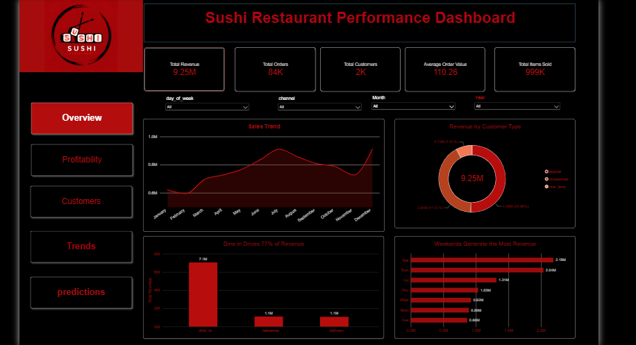
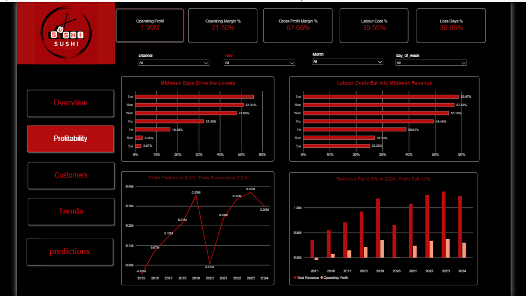
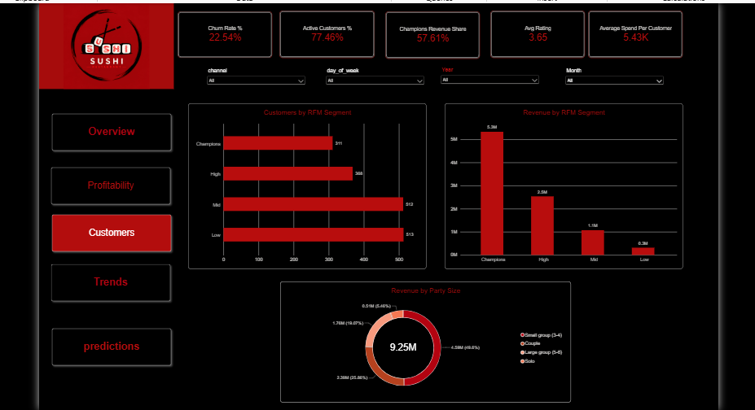
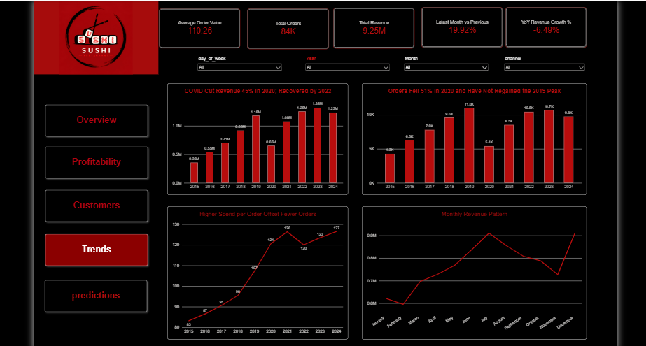
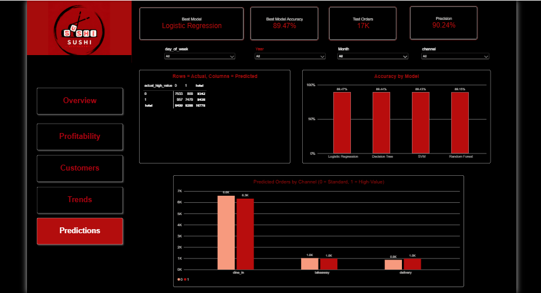

# 🍣 Sushi Restaurant Performance Analytics

End-to-end analysis of a sushi restaurant (2015–2024): data cleaning in Python,
a 5-page Power BI dashboard with 35+ DAX measures, and ML models to predict high-value orders.

## 1. Business Problem
The restaurant has strong weekend sales but faces loss-making days, high labour
costs, and declining profit in 2024. Management needs to know **where profit is
lost, who the most valuable customers are, and how the business recovered after COVID.**

**Objectives**
- Track revenue, orders, customers, AOV, and items sold
- Identify profitable vs. loss-making days and the cost drivers behind them
- Segment customers (RFM) and measure churn
- Predict high-value orders
- Give management actionable recommendations

## 2. Data
~84K orders | ~1.7K customers | ~1M order items | 2015–2024 | Channels: dine-in, delivery, takeaway

| Table | Description |
|---|---|
| orders | One row per order: date, channel, customer segment, party size, revenue, COGS, gross profit, discount, tip, delivery fee, rating |
| order_items | Items inside each order: item, category, unit price, COGS, gross profit |
| customers | Customer segment, join date, local/non-local, alcohol preference |
| daily_pnl | Daily covers, revenue, COGS, labour cost, fixed costs, operating profit |
| reviews | Customer ratings (1–5) by date and channel |
| staff | Hire/termination dates and base hourly rate |

## 3. Data Cleaning & Feature Engineering (Python)
**Quality checks (all 6 tables)**
- Missing values: the only significant gap was `rating` in orders (not every order
  gets a review). It was kept as null and a `has_review` flag was added, instead of
  filling it with made-up ratings.
- Duplicates: checked per table, and for order_items at the order + item level.
- Data types: converted all date columns to datetime.
- Outliers: detected with the IQR method. Capped copies were created for revenue,
  COGS, gross profit and tip, and the original columns were kept.
- Category consistency: checked unique values of channel, segment, day, month.

**Business-rule validation**
- gross_profit = revenue − cogs
- total_collected = revenue − discount + tip + delivery_fee
- operating_profit = gross_profit − labour_cost − fixed_ops_cost
- order_items totals reconcile with orders revenue and profit
- Delivery fees only on delivery orders; ratings between 1 and 5; party size > 0;
  termination date after hire date

**Feature engineering**
- Time/context: season, `covid_period` (Lockdown: Mar–May 2020, Recovery: Jun 2020–Dec 2021)
- Orders: revenue per person, discount %, tip %, party group, items per person, has_alcohol
- Customers: RFM scores and segments (Low / Mid / High / Champions);
  **churned = no order in the last 180 days**
- Daily P&L: labour %, operating margin %, revenue per cover, loss-day flag

## 4. Architecture
Raw data (6 CSV tables) → Python (cleaning, feature engineering, ML) → Power BI data model → 5-page dashboard

## 5. KPIs
| KPI | Value | Why it matters |
|---|---|---|
| Total Revenue | 9.25M | Overall business size |
| Average Order Value | 110.26 | Spend per visit |
| Operating Margin | 21.5% | Profitability after costs |
| Labour Cost % | 39.55% | Biggest controllable cost |
| Loss Days % | 30.06% | Share of days losing money |
| Churn Rate | 22.54% | Customer retention health |
| Champions Revenue Share | 57.61% | Dependence on top customers |

## 6. Dashboard (5 pages)
**Overview** · **Profitability** · **Customers** · **Trends** · **Predictions**

## 7. Key Insights
1. **Midweek is the profit problem.** 30% of days are loss-making, peaking on
   Tuesday (56%) and Monday (51%) vs. under 4% on Sat/Sun. Labour cost reaches
   55–59% of revenue Mon–Wed vs. ~25% on weekends.
2. **Weekends carry the business.** Saturday and Sunday generate ~46% of revenue.
   Dine-in accounts for 77% of total revenue.
3. **COVID impact:** in 2020 revenue fell 45% and orders 51%. Dine-in share
   dropped to ~52% while delivery rose to ~29%. Revenue recovered by 2022.
4. **Recovery is price-driven, not traffic-driven.** 2024 orders are still ~11%
   below the 2019 peak, while average order value rose from 107 to 127.
5. **2024 warning sign:** revenue fell 6.5% but operating profit fell 19%.
6. **Customer concentration:** Champions (~18% of customers) generate 57.6% of
   revenue. Churn rate is 22.5%.
7. **Prediction model:** a high-value order is one with revenue above the median.
   Logistic Regression identifies them with 89.5% accuracy and 90.2% precision.

## 8. Recommendations
1. **Flexible midweek staffing:** align shifts with demand on Mon–Wed to bring
   labour cost down and cut loss days.
2. **Midweek promotions** (set menus, happy hour) to lift volume on weak days.
3. **Loyalty program for Champions** and win-back offers for at-risk customers
   to protect the 57.6% revenue share and reduce churn.
4. **Grow delivery and takeaway** to reduce dependence on dine-in during disruptions.
5. **Use the model's drivers** (channel, day, party size) to design offers that
   encourage high-value orders.

## 9. Decisions & Trade-offs
- **Target definition:** high-value = revenue ≥ median revenue, calculated on the
  training set only, so the test set does not influence the threshold.
- **Data leakage:** removed revenue, total_collected, gross_profit, COGS, items count
  and average item price from the features, since they reveal the order value directly.
- **Model choice:** four models were compared (Logistic Regression, Decision Tree,
  Random Forest, SVM) and all scored within 0.3%, so Logistic Regression was chosen
  as the simplest and most interpretable.
- **Split:** 80/20 train/test (~17K test orders).
- **SVM** was trained on a 20K-row sample because of training time.
- **Why Python for cleaning:** ~84K orders and ~1M item rows, with reproducible
  validation checks and ML in the same workflow.
- **Why Power BI for the dashboard:** interactive filters and DAX KPIs for management.

## 10. Tools
Python (pandas, scikit-learn) · Power BI · DAX
